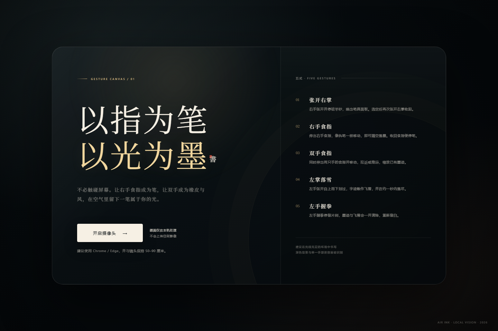

# 空书 · AIR INK

以指为笔，以光为墨。一个完全在浏览器本地运行的隔空书写交互实验。



## 功能

- **右手食指书写**：伸出右手食指即可隔空落墨，收回食指停笔
- **右手张开手掌**：停驻半秒唤出笔具面板，可切换画笔 / 橡皮、颜色与笔锋
- **食指悬停选择**：用手部光标在面板中停留即可选中工具
- **双手食指缩放**：两只手同时伸出食指，拉近或推远缩放全部笔迹
- **左掌下滑化雪**：左手张开自上而下划过，笔迹散作飞雪，约一秒内落尽
- **左手握拳清除**：保持左拳约半秒，清除全部笔迹与飞雪
- **本地识别**：手势模型与推理全部在本机完成，不会上传摄像头画面

## 运行

环境要求：Node.js 20.19+，Chrome 或 Edge，以及可用的摄像头。

```bash
npm install
npm run dev
```

打开终端输出的本地地址即可。摄像头需要在 `localhost` 或 HTTPS 环境下使用。

生产构建：

```bash
npm run build
npm run preview
```

## 手势一览

| 手势 | 动作 |
| --- | --- |
| 张开右掌 | 唤出 / 收起笔具面板 |
| 右手食指 | 书写与擦除 |
| 食指悬停 | 选择面板中的工具、颜色与笔锋 |
| 双手食指 | 缩放已有笔迹 |
| 左掌下滑 | 让笔迹化作飞雪 |
| 左手握拳 | 清除全部痕迹 |

## 技术说明

- [MediaPipe Tasks Vision](https://github.com/google-ai-edge/mediapipe) Hand Landmarker，双模型手势追踪
- Canvas 2D 矢量笔迹、橡皮擦与雪花粒子系统
- 2D / 3D / 深度联合的手指伸展判断，适应不同手势角度
- 原生 HTML / CSS / JavaScript，Vite 仅作为开发与构建工具

`public/mediapipe/` 内含运行所需的 MediaPipe Tasks Vision 脚本、WASM 推理引擎与手部关键点模型，来自 `@mediapipe/tasks-vision@0.10.14` 与 MediaPipe Hand Landmarker，遵循 Apache License 2.0。

## 目录

```text
air-ink/
├─ index.html              # 应用入口与全部 UI / 逻辑
├─ public/mediapipe/       # 本地手势推理运行时与模型
├─ docs/preview.png        # 项目预览图
├─ package.json
└─ vite.config.js
```
